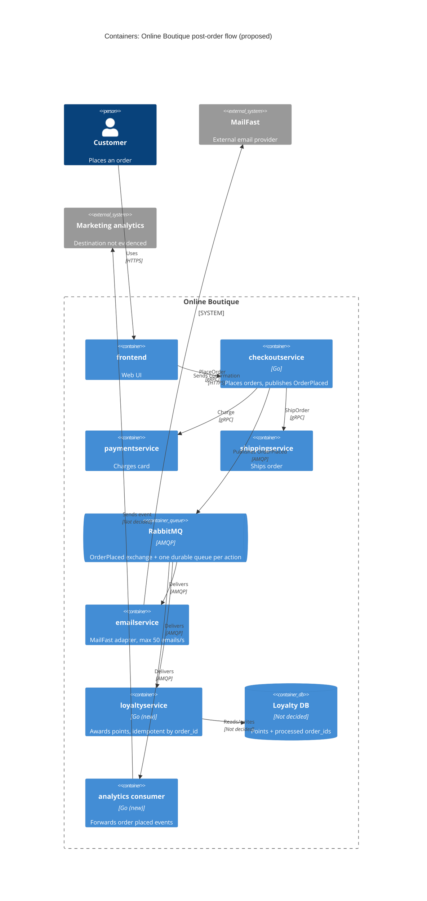

> ร่างแรกโดย Claude Code (Opus 5.5) แก้ไขและรับรองโดย นันทภัทร์ จั่นสนิท

  

# ADR-0002: Publish an "OrderPlaced" event to RabbitMQ for post-order actions

  

- **Status:** Proposed
- **Date:** 2026-10-25
- **Deciders:** นันทภัทร์ จั่นสนิท (สถาปนิก Architecture)

## Context and problem

  
Requirement R-12 (`docs/scenario.md`) กำหนดว่า หลังจากสั่งซื้อสำเร็จ ระบบต้อง (1) ส่งอีเมลยืนยันผ่าน **MailFast** (ผู้ให้บริการภายนอกรายใหม่ แทน logic จำลองใน `emailservice`) (2) มอบ loyalty points ผ่าน `loyaltyservice` ที่ต้องสร้างใหม่ และ (3) บันทึก analytics event "order placed" ให้ทีมการตลาด และทีมการตลาดคาดว่าจะมี post-order action เพิ่มอีกในปีหน้า (SMS, fraud scoring, recommendations update)

  

**ระบบปัจจุบัน (จากโค้ด):**

  

| ข้อเท็จจริง                                                                                                        | หลักฐาน                                                                             |
| ------------------------------------------------------------------------------------------------------------------ | ----------------------------------------------------------------------------------- |
| `PlaceOrder` เรียก `chargeCard` → `shipOrder` → `emptyUserCart` → `sendOrderConfirmation` ตามลำดับ แบบ synchronous | `system/online-boutique/src/checkoutservice/main.go` (`PlaceOrder`, บรรทัด 252–277) |
| ทุก dependency เป็น gRPC client ที่ตั้งค่าจาก env var (`EMAIL_SERVICE_ADDR` ฯลฯ)                                   | `main.go` (`mustMapEnv`, `mustConnGRPC`, บรรทัด 111–123, 210–220)                   |
| ถ้าส่งอีเมลล้มเหลว จะแค่ `log.Warnf` และคำสั่งซื้อยังสำเร็จ                                                        | `main.go` บรรทัด 273–277                                                            |
| การเรียก email ใช้ `ctx` ของ request เดียวกัน ไม่มี timeout แยก                                                    | `main.go` (`sendOrderConfirmation`, บรรทัด 379–384)                                 |
| order ID สร้างด้วย `uuid.NewUUID()` ก่อนตัดบัตร — ใช้เป็น idempotency key ได้                                      | `main.go` บรรทัด 233                                                                |
| `checkoutservice` ไม่มี data store ของตัวเอง                                                                       | ไม่พบการเชื่อมต่อ database ใน `main.go`                                             |

  

**ตัวเลขที่สำคัญ (`docs/scenario.md`):**

  

| หัวข้อ               | ค่า                                                                                             | ผลต่อการตัดสินใจ                                                                                     |
| -------------------- | ----------------------------------------------------------------------------------------------- | ---------------------------------------------------------------------------------------------------- |
| p95 ของ `PlaceOrder` | ≤ 500 ms (ปัจจุบันประมาณ 300 ms)                                                                | เหลือ budget ประมาณ 200 ms สำหรับงานใหม่ทั้งหมด                                                      |
| MailFast             | p95 1.5 s, p99 8 s, ล้มเหลวประมาณ 0.5 %, rate limit 50 emails/s                                 | เรียกแบบ synchronous ไม่ได้: p95 ของ MailFast เพียงตัวเดียวเกิน budget 500 ms แล้ว                   |
| Peak load            | 200 orders/s (11.11)                                                                            | สูงกว่า rate limit ของ MailFast 4 เท่า → backlog เพิ่มประมาณ 150 emails/s ระหว่าง peak ต้องมี buffer |
| Loyalty points       | ภายใน 1 นาที และ exactly once                                                                   | ต้องมี idempotency และ consumer ที่รับ 200 events/s ได้                                              |
| Availability         | คำสั่งซื้อห้ามล้มเพราะ email / loyalty / analytics ล่ม                                          | ต้องแยก failure ของ post-order action ออกจาก checkout                                                |
| Team / Ops           | 4 developers ถนัด Go + gRPC, 2 คนเคยใช้ RabbitMQ; รันบน Kubernetes; ชอบ open-source self-hosted | เอนเอียงไปทาง broker ที่ self-host ได้และทีมคุ้นเคย                                                  |

  

**ปัญหาที่ต้องตัดสินใจ:** `checkoutservice` ควรสั่งงาน post-order action ทั้งสาม (และงานในอนาคต) อย่างไร ให้ไม่กระทบ latency และ availability ของ checkout แต่ยังได้ loyalty points ภายใน 1 นาทีแบบ exactly once

  

## Decision drivers

  

1. **Availability:** คำสั่งซื้อต้องไม่ล้มเพราะ MailFast, `loyaltyservice` หรือ analytics ล่ม

2. **Performance:** p95 ของ `PlaceOrder` ≤ 500 ms ที่ 200 orders/s

3. **Correctness ของ loyalty points:** exactly once (ไม่ให้แต้มซ้ำ) ภายใน 1 นาที

4. **Modifiability / extensibility:** เพิ่ม post-order action ใหม่ (SMS, fraud scoring, recommendations) ได้โดยไม่ต้องแก้ `checkoutservice` ทุกครั้ง

5. **ข้อจำกัดภายนอก:** เคารพ rate limit 50 emails/s ของ MailFast และรับมือ p99 8 s / failure 0.5 % ได้

6. **Cost และ team fit:** open-source, self-hosted บน Kubernetes, ทีมเล็ก 4 คน

  

## Considered options

  

1. **Synchronous gRPC ต่อท้าย `PlaceOrder`** — เพิ่มการเรียก `loyaltyservice` และ analytics ต่อจาก `sendOrderConfirmation` และให้ `emailservice` เรียก MailFast ภายใน (ขยายรูปแบบเดิม)

2. **Asynchronous ภายใน process (goroutine fire-and-forget)** — `PlaceOrder` ตอบกลับทันที แล้วใช้ goroutine เรียก gRPC ไปยังแต่ละ service พร้อม retry ในหน่วยความจำ

3. **Publish event `OrderPlaced` ไปยัง RabbitMQ (self-hosted)** — `checkoutservice` publish หนึ่ง event; `emailservice` (MailFast adapter), `loyaltyservice` และ analytics consumer subscribe คนละ queue

4. **Publish event ไปยัง Apache Kafka (self-hosted)** — แบบเดียวกับข้อ 3 แต่ใช้ log-based broker

  

### Pros and cons of the options

  

| Option             | Pros                                                                                                                                                                                                                                                                                                                                      | Cons                                                                                                                                                                                                                                                                 |
| ------------------ | ----------------------------------------------------------------------------------------------------------------------------------------------------------------------------------------------------------------------------------------------------------------------------------------------------------------------------------------- | -------------------------------------------------------------------------------------------------------------------------------------------------------------------------------------------------------------------------------------------------------------------- |
| 1. Sync gRPC       | เรียบง่าย ไม่มีส่วนประกอบใหม่; ทีมถนัด gRPC; ได้ผลลัพธ์ทันที                                                                                                                                                                                                                                                                              | p95 MailFast 1.5 s ทำให้ p95 `PlaceOrder` เกิน 500 ms แน่นอน; rate limit 50/s < 200 orders/s → request ค้างหรือถูกปฏิเสธ; `checkoutservice` coupled กับทุก action ใหม่ (ต้องแก้โค้ดและ env var ทุกครั้ง); retry ทำให้ latency แย่ลง                                  |
| 2. Goroutine async | latency ของ checkout ไม่ขึ้นกับ action ใหม่; ไม่มี infrastructure เพิ่ม                                                                                                                                                                                                                                                                   | งานสูญหายเมื่อ pod restart / scale down (ละเมิด "loyalty ต้องได้แต้ม"); ไม่มี buffer ที่ทนทานสำหรับ backlog ช่วง peak; rate limiting ต้องประสานข้ามหลาย replica; `checkoutservice` ยังต้องรู้จักทุก consumer (modifiability ต่ำ)                                     |
| 3. RabbitMQ        | decouple: checkout publish ครั้งเดียว ใช้เวลาเพียงไม่กี่ ms [Inferred]; durable queue เป็น buffer สำหรับ backlog email ช่วง 11.11; consumer ของ email คุม throughput ≤ 50/s ได้ (prefetch / จำนวน consumer); เพิ่ม action ใหม่ = เพิ่ม queue + consumer โดยไม่แตะ checkout; open-source, self-host บน Kubernetes ได้; 2 developers เคยใช้ | ส่วนประกอบ stateful ใหม่ที่ต้องดูแล; delivery เป็น at-least-once → ต้องทำ idempotency ใน `loyaltyservice` เอง; consistency ระหว่าง "order สำเร็จ" กับ "event ถูก publish" ไม่รับประกันเพราะ `checkoutservice` ไม่มี DB สำหรับ outbox; debug/trace ข้าม async ยากขึ้น |
| 4. Kafka           | throughput สูงมาก; replay event ย้อนหลังได้ (มีประโยชน์กับ analytics และ consumer ใหม่ในอนาคต); open-source                                                                                                                                                                                                                               | ไม่ทราบว่าทีมมีประสบการณ์กับ Kafka หรือไม่; operate ยากกว่าสำหรับทีม 4 คน; 200 events/s ไม่ต้องการ throughput ระดับนี้; per-message rate limiting / retry / dead-letter ต้องทำเองมากกว่า; ยังต้องทำ idempotency เหมือนเดิม                                           |

  

## Decision

เลือก **Option 3: publish event `OrderPlaced` ไปยัง RabbitMQ ที่ self-host บน Kubernetes**

  

- `checkoutservice.PlaceOrder` แทนที่การเรียก `sendOrderConfirmation` (`main.go` บรรทัด 273–277) ด้วยการ publish `OrderPlaced` หนึ่งครั้ง (มี `order_id`, email, รายการสินค้า, ยอดรวม) ไปยัง exchange แบบ fanout/topic พร้อม publisher confirms และ timeout สั้น ถ้า publish ไม่สำเร็จ **คำสั่งซื้อยังสำเร็จ** (คงพฤติกรรมเดิมที่ log warning) แต่ต้องมี fallback ดู Risks

- แต่ละ action มี durable queue ของตัวเอง:

  - `emailservice` → เรียก MailFast; จำกัด throughput ≤ 50 emails/s; retry พร้อม backoff สำหรับ failure 0.5 %; ส่งต่อ dead-letter queue เมื่อ retry ครบ

  - `loyaltyservice` (ใหม่, Go) → ให้แต้มแบบ idempotent โดยใช้ `order_id` เป็น key (บันทึก "order นี้ให้แต้มแล้ว" ใน transaction เดียวกับการเพิ่มแต้ม) เพื่อให้ at-least-once delivery กลายเป็น effectively exactly once

  - analytics consumer → ส่ง event ให้ทีมการตลาด (ปลายทาง Not evidenced in the provided files)

- action ในอนาคต (SMS, fraud scoring, recommendations) ทำเป็น queue + consumer ใหม่โดยไม่ต้องแก้ `checkoutservice`

  

**เหตุผล:** เป็นตัวเลือกเดียวที่ตอบ driver 1–5 พร้อมกัน — Option 1 ละเมิด latency และ rate limit, Option 2 ทำ event หายและละเมิด loyalty, Option 4 ตอบโจทย์ได้แต่เกินความจำเป็นที่ 200 events/s และทีมมีประสบการณ์กับ RabbitMQ อยู่แล้ว 2 คน (driver 6) 

  

  

## Consequences

  

- **Positive:** latency ของ `PlaceOrder` ไม่ขึ้นกับ MailFast (p95 1.5 s / p99 8 s) อีกต่อไป เพราะเพิ่มแค่การ publish หนึ่งครั้ง (quality attribute: performance)

- **Positive:** MailFast, `loyaltyservice` หรือ analytics ล่มไม่ทำให้คำสั่งซื้อล้ม; event รออยู่ใน durable queue จนกว่า consumer จะกลับมา (quality attribute: availability)

- **Positive:** queue ของ email ดูดซับ backlog ช่วง 11.11 (200 orders/s เทียบกับ 50 emails/s) และคุม rate ไม่ให้เกิน limit (quality attribute: scalability / reliability)

- **Positive:** เพิ่ม post-order action ใหม่ได้โดยไม่แก้ `checkoutservice` (quality attribute: modifiability / extensibility)

- **Negative:** อีเมลยืนยันอาจล่าช้าช่วง peak — ถ้า peak 200 orders/s ยาว *T* วินาที backlog ประมาณ 150 × *T* emails ใช้เวลาระบายประมาณ 3 × *T* วินาทีหลัง peak (ความยาวของ peak Not evidenced; ดู Open questions) (quality attribute: user-perceived timeliness)

- **Negative:** มีส่วนประกอบ stateful ใหม่ต้อง deploy, monitor, backup และ upgrade บน Kubernetes โดยทีม 4 คน (quality attribute: operability / cost)

- **Negative:** eventual consistency และ at-least-once delivery ทำให้ต้องเขียน idempotent consumer และ trace ข้าม async boundary ยากขึ้น (quality attribute: modifiability / testability / observability)

- **Risks and mitigations:**

  - *RabbitMQ ล่มขณะ checkout* → order ต้องไม่ล้ม แต่ event อาจหายและลูกค้าไม่ได้แต้ม (ขัดกับ requirement loyalty) → mitigation: RabbitMQ แบบ clustered + quorum queues; ใน `checkoutservice` ใช้ publisher confirms + timeout สั้น + retry buffer; ระยะยาวพิจารณา transactional outbox ซึ่งต้องมี DB ที่ `checkoutservice` ยังไม่มี (Not evidenced in the provided files)

  - *Loyalty ได้แต้มซ้ำจาก redelivery* → idempotency key = `order_id` (สร้างที่ `main.go` บรรทัด 233) พร้อม unique constraint ใน Loyalty DB

  - *Loyalty เกิน 1 นาทีช่วง peak* → scale consumer ของ `loyaltyservice` ให้รับ ≥ 200 events/s และแยก queue ของ loyalty จาก email ไม่ให้ backlog ของ email มาหน่วง

  - *MailFast ล้มเหลว 0.5 % / ช้า p99 8 s* → retry with backoff, timeout ฝั่ง consumer, dead-letter queue + alert

  - *Event schema เปลี่ยนแล้วกระทบ consumer* → กำหนด schema ของ `OrderPlaced` ใน protobuf (ทีมถนัด) และ version ไว้

  

## Validation

  

- **Load test** ด้วย `loadgenerator`  ที่ 200 orders/s: p95 ของ `PlaceOrder` ≤ 500 ms

- **Loyalty SLO:** วัดเวลาจาก `OrderPlaced` ถึงการให้แต้ม — p100 ≤ 60 s ระหว่าง load test; จำนวน order ที่ได้แต้มซ้ำ = 0 (ตรวจจาก unique `order_id`)

- **Failure injection:** ปิด `emailservice`, `loyaltyservice`, analytics consumer และ MailFast (mock) ทีละตัว → อัตราความสำเร็จของ checkout ต้องไม่ลดลง และ event ถูกประมวลผลครบเมื่อกลับมา

- **Redelivery test:** ส่ง `OrderPlaced` เดิมซ้ำหลายครั้ง → แต้มเพิ่มเพียงครั้งเดียว

- **Metrics ต่อเนื่อง:** queue depth, consumer lag, MailFast send rate (≤ 50/s), dead-letter count, publish failure ใน `checkoutservice`

- ทบทวน ADR นี้หลัง 11.11 ครั้งแรก หรือเมื่อเพิ่ม post-order action ตัวที่สี่ (วันที่ทบทวนยังไม่กำหนด)

  

## Open questions

  

- Peak 200 orders/s นานเท่าไร? (ใช้คำนวณ backlog ของ email และขนาด queue / disk ของ RabbitMQ)

- อีเมลยืนยันยอมให้ล่าช้าได้สูงสุดเท่าไร? scenario ไม่กำหนด SLO ของอีเมล

- ยอมรับได้หรือไม่ที่ event จะหายในกรณีที่ RabbitMQ ล่มขณะ checkout? ถ้าไม่ได้ ต้องเพิ่ม DB ให้ `checkoutservice` เพื่อทำ outbox — ใครเป็นเจ้าของการตัดสินใจนี้?

- `loyaltyservice` จะใช้ data store อะไร และกติกาการคำนวณแต้มเป็นอย่างไร?

- ปลายทางของ analytics event ของทีมการตลาดคืออะไร (ระบบ, protocol, schema)? และยอมให้ event หาย/ซ้ำได้หรือไม่?

- MailFast มี API แบบใด (HTTPS/SMTP), รองรับ idempotency key หรือไม่ (ป้องกันอีเมลซ้ำเมื่อ retry), และมี batch API หรือขอเพิ่ม rate limit ได้หรือไม่?

- ภาษาและ runtime ของ `emailservice`, `paymentservice`, `shippingservice` — Not evidenced in the provided files (ไม่ได้อยู่ใน context)

- RabbitMQ จะใช้แบบ operator บน Kubernetes หรือ Helm chart, และใครรับผิดชอบ on-call?

- ทีมมีประสบการณ์กับ Kafka หรือไม่?