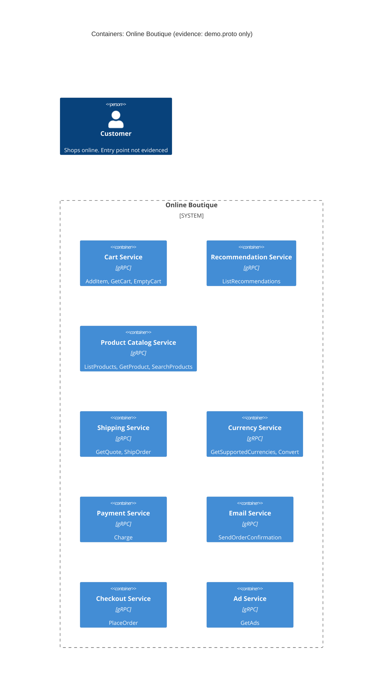

# Task 1 · Run A · Recovered C4 container architecture

## 1. Agent

Claude Code (Anthropic), model Claude Opus 5.5 (`claude-opus-5-5`).

## 2. Files read

- `prompts/1-recover-architecture.md` (task instructions)
- `system/online-boutique/protos/demo.proto` (the only evidence)

## 3. Containers table

All services are declared in one proto3 package `hipstershop` (`demo.proto` line 17). The proto defines the **interface** of each service. It does not say what language implements it.

| Container | Technology / language | Responsibility | Evidence |
|---|---|---|---|
| Cart Service | gRPC (proto3). Language: Not evidenced in the provided files | Add items, get a user's cart, empty a cart | `system/online-boutique/protos/demo.proto` (`service CartService`: `AddItem`, `GetCart`, `EmptyCart`) |
| Recommendation Service | gRPC (proto3). Language: Not evidenced | Recommend product IDs for a user and a list of products | `demo.proto` (`service RecommendationService`: `ListRecommendations`) |
| Product Catalog Service | gRPC (proto3). Language: Not evidenced | List, get and search products (id, name, description, picture, `price_usd`, categories) | `demo.proto` (`service ProductCatalogService`: `ListProducts`, `GetProduct`, `SearchProducts`; `message Product`) |
| Shipping Service | gRPC (proto3). Language: Not evidenced | Quote shipping cost for an address and items; ship an order and return a tracking ID | `demo.proto` (`service ShippingService`: `GetQuote`, `ShipOrder`) |
| Currency Service | gRPC (proto3). Language: Not evidenced | List supported currencies; convert `Money` between ISO 4217 currencies | `demo.proto` (`service CurrencyService`: `GetSupportedCurrencies`, `Convert`) |
| Payment Service | gRPC (proto3). Language: Not evidenced | Charge a credit card for an amount; return a transaction ID | `demo.proto` (`service PaymentService`: `Charge`; `message CreditCardInfo`) |
| Email Service | gRPC (proto3). Language: Not evidenced | Send an order confirmation to an email address | `demo.proto` (`service EmailService`: `SendOrderConfirmation`) |
| Checkout Service | gRPC (proto3). Language: Not evidenced | Place an order (user, currency, address, email, credit card) and return an `OrderResult` | `demo.proto` (`service CheckoutService`: `PlaceOrder`) |
| Ad Service | gRPC (proto3). Language: Not evidenced | Return text ads for page context keywords | `demo.proto` (`service AdService`: `GetAds`) |

Data stores and message brokers: **Not evidenced in the provided files.** The proto declares no database, cache or queue.

## 4. Dependencies table

A `.proto` file declares which services **offer** which RPCs. It does not declare which service **calls** which. So no caller → callee dependency can be proven from this evidence.

| Caller → callee | Protocol | Evidence |
|---|---|---|
| *(none evidenced)* | gRPC is the protocol of every service interface | `demo.proto` (`service …` declarations with `rpc` methods). The caller side is not shown |

Candidate dependencies suggested by shared message types are listed under **Gaps** ([Inferred]), not here.

## 5. Mermaid diagram

The diagram matches the tables: nine gRPC containers and no `Rel`, because no dependency is evidenced. The end user is shown, but how they reach the system (e.g. a web frontend) is not evidenced, so they have no `Rel` either.

## 6. Gaps

| Gap | Why it is open | File that would settle it |
|---|---|---|
| Who calls whom (all runtime dependencies) | Proto shows servers, not clients | `system/online-boutique/kubernetes-manifests/*.yaml` (env vars such as `*_SERVICE_ADDR`), or each service's client code in `system/online-boutique/src/*/` |
| [Inferred] `checkoutservice` → cart, catalog, currency, shipping, payment, email | `PlaceOrderRequest` carries `Address`, `CreditCardInfo`, `email`, `user_currency`, and `OrderResult` carries `shipping_tracking_id` and `OrderItem.cost`. These match the inputs/outputs of `ShipOrder`, `Charge`, `SendOrderConfirmation`, `Convert`, `GetCart`. Not proof | `kubernetes-manifests/checkoutservice.yaml`; `src/checkoutservice/` |
| [Inferred] `recommendationservice` → `productcatalogservice` | It returns product IDs, so it may read the catalog | `kubernetes-manifests/recommendationservice.yaml`; `src/recommendationservice/` |
| User entry point (web frontend?) and its protocol to the user | No frontend service in the proto; it would be an HTTP client of these services, not a gRPC server | `kubernetes-manifests/frontend.yaml`; `src/frontend/` |
| Implementation language of each service | Proto is language-neutral (only `go_package` is set, which is a code-generation option, not proof the services are Go) | `src/*/` (e.g. `Dockerfile`, `go.mod`, `package.json`, `*.csproj`) |
| Data stores (e.g. where carts are kept) | No storage declared | `kubernetes-manifests/` (e.g. a Redis manifest), `src/cartservice/` |
| External systems (real payment provider, mail server) | `Charge` and `SendOrderConfirmation` may be mocks or call outside systems | `src/paymentservice/`, `src/emailservice/` |
| Load generator / test client | Not in the proto | `kubernetes-manifests/loadgenerator.yaml` |
