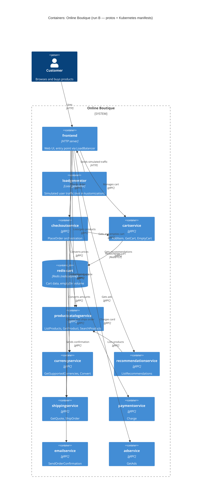

# Task 1 — Recovered architecture (run B)

## 1. Agent

- Product: Claude Code (VS Code extension)
- Model: Claude Opus 5.5 (`claude-opus-5-5`)

## 2. Files read

ไฟล์ evidence ที่เปิดอ่าน (ทั้งหมดอยู่ใน evidence ที่อนุญาต):

- `system/online-boutique/protos/demo.proto`
- `system/online-boutique/kubernetes-manifests/README.md`
- `system/online-boutique/kubernetes-manifests/kustomization.yaml`
- `system/online-boutique/kubernetes-manifests/adservice.yaml`
- `system/online-boutique/kubernetes-manifests/cartservice.yaml`
- `system/online-boutique/kubernetes-manifests/checkoutservice.yaml`
- `system/online-boutique/kubernetes-manifests/currencyservice.yaml`
- `system/online-boutique/kubernetes-manifests/emailservice.yaml`
- `system/online-boutique/kubernetes-manifests/frontend.yaml`
- `system/online-boutique/kubernetes-manifests/loadgenerator.yaml`
- `system/online-boutique/kubernetes-manifests/paymentservice.yaml`
- `system/online-boutique/kubernetes-manifests/productcatalogservice.yaml`
- `system/online-boutique/kubernetes-manifests/recommendationservice.yaml`
- `system/online-boutique/kubernetes-manifests/shippingservice.yaml`

ไฟล์คำสั่งงาน: `prompts/1-recover-architecture.md` (และ `AGENTS.md` ซึ่งถูกโหลดเป็นกฎของ repository)

## 3. Containers table

หมายเหตุ: manifest ระบุแค่ `image: <ชื่อ service>` (ยังไม่ได้ใส่ tag ตาม `kubernetes-manifests/README.md`) จึงไม่มีหลักฐานว่าแต่ละ service เขียนด้วยภาษาอะไร ช่อง technology จึงระบุเฉพาะสิ่งที่ evidence แสดง

| Container | Technology / language | Responsibility | Evidence |
|---|---|---|---|
| `frontend` | HTTP server, port 8080; ภาษา: Not evidenced in the provided files | Web UI ของร้าน เป็นจุดเข้าระบบเพียงจุดเดียวจากภายนอก และเรียก backend services | `kubernetes-manifests/frontend.yaml` (`Service frontend-external`, `type: LoadBalancer`; `httpGet path: "/_healthz"`; cookie `shop_session-id`) |
| `cartservice` | gRPC server, port 7070; ภาษา: Not evidenced | จัดการตะกร้าสินค้า: `AddItem`, `GetCart`, `EmptyCart` | `protos/demo.proto` (`service CartService`); `kubernetes-manifests/cartservice.yaml` (`readinessProbe.grpc`, port name `grpc`) |
| `redis-cart` (ContainerDb) | Redis (`redis:alpine`), port 6379 | เก็บข้อมูลตะกร้า; volume เป็น `emptyDir` (ข้อมูลหายเมื่อ pod ถูกลบ) | `kubernetes-manifests/cartservice.yaml` (`Deployment redis-cart`, `image: redis:alpine`, `volumes: redis-data emptyDir`) |
| `productcatalogservice` | gRPC server, port 3550; ภาษา: Not evidenced | รายการสินค้า: `ListProducts`, `GetProduct`, `SearchProducts` | `protos/demo.proto` (`service ProductCatalogService`); `kubernetes-manifests/productcatalogservice.yaml` |
| `currencyservice` | gRPC server, port 7000; ภาษา: Not evidenced | แปลงสกุลเงิน: `GetSupportedCurrencies`, `Convert` | `protos/demo.proto` (`service CurrencyService`); `kubernetes-manifests/currencyservice.yaml` |
| `recommendationservice` | gRPC server, port 8080; ภาษา: Not evidenced | แนะนำสินค้า: `ListRecommendations` | `protos/demo.proto` (`service RecommendationService`); `kubernetes-manifests/recommendationservice.yaml` |
| `shippingservice` | gRPC server, port 50051; ภาษา: Not evidenced | ประเมินค่าส่งและส่งของ: `GetQuote`, `ShipOrder` | `protos/demo.proto` (`service ShippingService`); `kubernetes-manifests/shippingservice.yaml` |
| `checkoutservice` | gRPC server, port 5050; ภาษา: Not evidenced | ประสานการสั่งซื้อ: `PlaceOrder` (orchestrate cart, catalog, currency, shipping, payment, email) | `protos/demo.proto` (`service CheckoutService`); `kubernetes-manifests/checkoutservice.yaml` (env `*_SERVICE_ADDR` 6 ตัว) |
| `paymentservice` | gRPC server, port 50051; ภาษา: Not evidenced | ตัดเงินบัตรเครดิต: `Charge` → `transaction_id` | `protos/demo.proto` (`service PaymentService`); `kubernetes-manifests/paymentservice.yaml` |
| `emailservice` | gRPC server, container port 8080 / Service port 5000; ภาษา: Not evidenced | ส่งอีเมลยืนยันคำสั่งซื้อ: `SendOrderConfirmation` | `protos/demo.proto` (`service EmailService`); `kubernetes-manifests/emailservice.yaml` (`port: 5000`, `targetPort: 8080`) |
| `adservice` | gRPC server, port 9555; ภาษา: Not evidenced | แสดงโฆษณาตาม context: `GetAds` | `protos/demo.proto` (`service AdService`); `kubernetes-manifests/adservice.yaml` |
| `loadgenerator` | ไม่มี port/Service; ภาษา: Not evidenced (init container ใช้ `busybox`) | สร้าง traffic จำลองผู้ใช้ (`USERS=10`, `RATE=1`) ไปยัง frontend; **ไม่ได้อยู่ใน `kustomization.yaml`** (ถูก comment ไว้) | `kubernetes-manifests/loadgenerator.yaml` (`FRONTEND_ADDR`, `USERS`, `RATE`); `kubernetes-manifests/kustomization.yaml` (`# - loadgenerator.yaml`) |

## 4. Dependencies table

หลักฐานเรื่อง protocol gRPC มาจาก 3 แหล่งรวมกัน: (1) callee ประกาศใน `demo.proto` ว่าเป็น gRPC `service`, (2) Service port ของ callee ชื่อ `grpc`, (3) callee ใช้ `readinessProbe.grpc` ส่วนหลักฐานว่า caller เรียก callee คือ env var `*_ADDR` ใน manifest ของ caller

| Caller → Callee | Protocol | Evidence |
|---|---|---|
| Customer → `frontend` | HTTP (port 80 → 8080) | `frontend.yaml` (`Service frontend-external`, `type: LoadBalancer`, port name `http`) |
| `loadgenerator` → `frontend` | HTTP | `loadgenerator.yaml` (`FRONTEND_ADDR="frontend:80"`; init container `wget http://${FRONTEND_ADDR}`) |
| `frontend` → `productcatalogservice` | gRPC | `frontend.yaml` (`PRODUCT_CATALOG_SERVICE_ADDR="productcatalogservice:3550"`) |
| `frontend` → `currencyservice` | gRPC | `frontend.yaml` (`CURRENCY_SERVICE_ADDR="currencyservice:7000"`) |
| `frontend` → `cartservice` | gRPC | `frontend.yaml` (`CART_SERVICE_ADDR="cartservice:7070"`) |
| `frontend` → `recommendationservice` | gRPC | `frontend.yaml` (`RECOMMENDATION_SERVICE_ADDR="recommendationservice:8080"`) |
| `frontend` → `shippingservice` | gRPC | `frontend.yaml` (`SHIPPING_SERVICE_ADDR="shippingservice:50051"`) |
| `frontend` → `checkoutservice` | gRPC | `frontend.yaml` (`CHECKOUT_SERVICE_ADDR="checkoutservice:5050"`) |
| `frontend` → `adservice` | gRPC | `frontend.yaml` (`AD_SERVICE_ADDR="adservice:9555"`) |
| `checkoutservice` → `productcatalogservice` | gRPC | `checkoutservice.yaml` (`PRODUCT_CATALOG_SERVICE_ADDR="productcatalogservice:3550"`) |
| `checkoutservice` → `shippingservice` | gRPC | `checkoutservice.yaml` (`SHIPPING_SERVICE_ADDR="shippingservice:50051"`) |
| `checkoutservice` → `paymentservice` | gRPC | `checkoutservice.yaml` (`PAYMENT_SERVICE_ADDR="paymentservice:50051"`) |
| `checkoutservice` → `emailservice` | gRPC | `checkoutservice.yaml` (`EMAIL_SERVICE_ADDR="emailservice:5000"`) |
| `checkoutservice` → `currencyservice` | gRPC | `checkoutservice.yaml` (`CURRENCY_SERVICE_ADDR="currencyservice:7000"`) |
| `checkoutservice` → `cartservice` | gRPC | `checkoutservice.yaml` (`CART_SERVICE_ADDR="cartservice:7070"`) |
| `recommendationservice` → `productcatalogservice` | gRPC | `recommendationservice.yaml` (`PRODUCT_CATALOG_SERVICE_ADDR="productcatalogservice:3550"`) |
| `cartservice` → `redis-cart` | Redis protocol over TCP | `cartservice.yaml` (`REDIS_ADDR="redis-cart:6379"`; Service `redis-cart` port name `tcp-redis`) |

## 5. Mermaid diagram

## 6. Gaps

| Gap | ทำไมยังสรุปไม่ได้ | ไฟล์ที่จะช่วยยืนยัน |
|---|---|---|
| ภาษา/technology ของแต่ละ service | manifest ใช้ `image: <name>` ที่ไม่มี tag และไม่บอกภาษา | `system/online-boutique/src/<service>/Dockerfile` หรือ source code ของแต่ละ service; หรือ `release/kubernetes-manifests.yaml` (image เต็ม) |
| `shoppingassistantservice` | `frontend.yaml` มี env `SHOPPING_ASSISTANT_SERVICE_ADDR="shoppingassistantservice:80"` แต่ไม่มี manifest ในโฟลเดอร์นี้ และ `kustomization.yaml` comment `../kustomize/components/shopping-assistant` ไว้ จึงไม่ใส่ใน diagram | `system/online-boutique/kustomize/components/shopping-assistant/` และ source ของ `frontend` |
| Optional "packaging service" | `frontend.yaml` มี `PACKAGING_SERVICE_URL` แต่ถูก comment ไว้ | source ของ `frontend` |
| Operation ที่แต่ละ caller เรียกจริง (เช่น frontend เรียก `GetQuote` เท่านั้นหรือไม่, checkout เรียก `ShipOrder`) | env var บอกแค่ว่ามี connection ส่วน RPC ที่เรียกใน diagram เป็น **[Inferred]** จากชื่อ RPC ใน `demo.proto` | source ของ `frontend` และ `checkoutservice` |
| ระบบภายนอก (payment gateway จริง, SMTP/email provider) | `paymentservice` และ `emailservice` ไม่มี env var ชี้ไปยังระบบภายนอก — ไม่มีหลักฐานว่ามี `System_Ext` | source ของ `paymentservice` และ `emailservice` |
| frontend เป็น HTTPS หรือ HTTP ล้วน / มี Ingress หรือ TLS หรือไม่ | manifest แสดงเพียง LoadBalancer port 80 ชื่อ `http` | manifest ของ Ingress/Istio gateway (เช่น `system/online-boutique/istio-manifests/`) |
| การเข้ารหัส/การยืนยันตัวตนระหว่าง services (mTLS) | มี annotation `sidecar.istio.io/rewriteAppHTTPProbers` บ่งว่าอาจใช้กับ Istio **[Inferred]** แต่ไม่มี config | `system/online-boutique/istio-manifests/` |
| Data store แบบอื่น (Memorystore, AlloyDB, Spanner) | ถูก comment ไว้ใน `kustomization.yaml` เป็น optional components | `system/online-boutique/kustomize/components/{memorystore,alloydb,spanner}/` |
| แหล่งข้อมูลของ `productcatalogservice`, `currencyservice`, `adservice` | manifest ไม่มี env var หรือ volume ที่ชี้ไปยัง data store | source ของ services เหล่านั้น |
| ความทนทานของข้อมูลตะกร้า | `redis-cart` ใช้ `emptyDir` → ข้อมูลไม่ persistent **[Inferred]** ว่าตั้งใจเป็น demo | เอกสารออกแบบหรือ README ของระบบ |
